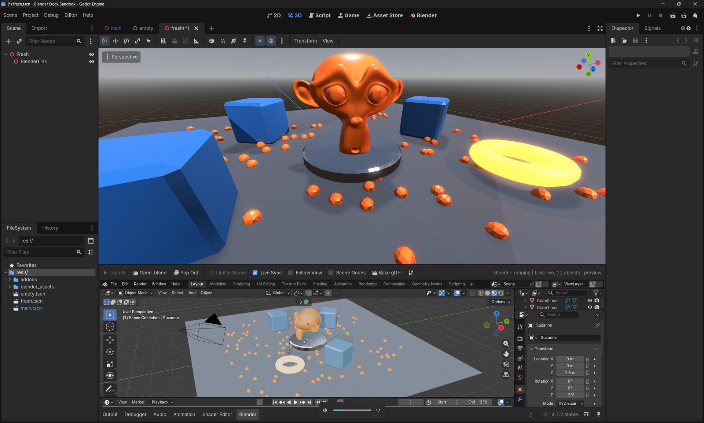
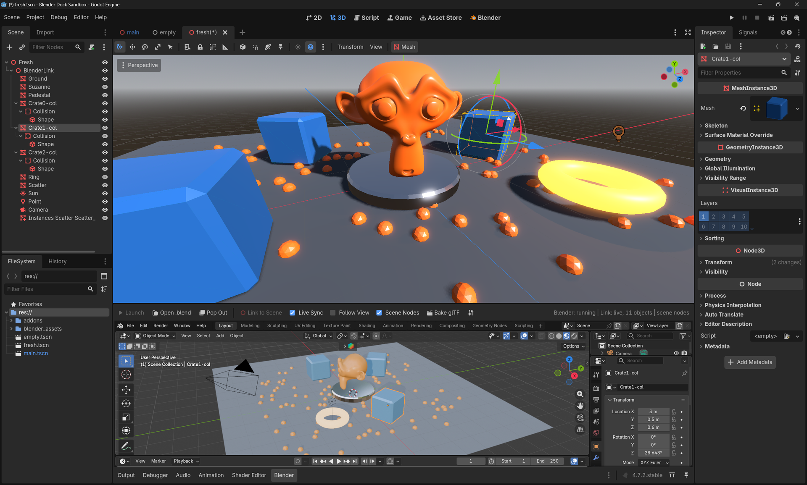
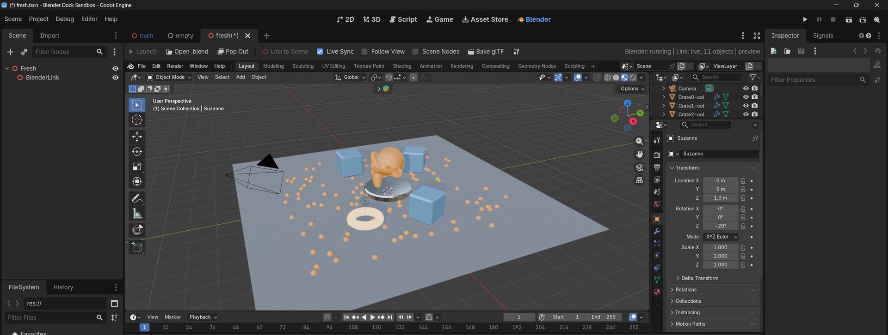

# Blender Dock for Godot

Run the real Blender inside the Godot 4.7 editor (Windows), with a live two-way link: what you model in Blender appears in your Godot scene as you work.




| Scene Nodes mode: selection synced both ways | Blender as a main-screen tab |
|---|---|
|  |  |

## Features
- **Blender inside Godot**:
  - a **Blender** main-screen tab next to 2D / 3D / Script, and a **Blender** dock (bottom by default, or a side slot or a floating window)
  - Blender starts invisibly behind a progress bar, and closes together with the editor
- **Live sync, Blender → Godot**, under a `BlenderLink` node:
  - hierarchy: object parenting and collections become nested `Node3D`s
  - meshes with modifiers, armatures and shape keys; UV, UV2, vertex colors, tangents
  - Principled BSDF materials, including base-color, normal, roughness, metallic and emission textures (packed textures are extracted)
  - lights, cameras, empties
  - geometry-node, collection and particle instances
  - collisions: name suffix `-col`, `-colonly`, `-convcol`, `-convcolonly`, or the **Godot** tab in Blender's sidebar
- **Two modes**:
  - **Preview** (default): drawn directly through the RenderingServer. Fastest; nothing is written to the scene.
  - **Scene Nodes**: real, selectable, saved nodes.
- **Godot ↔ Blender**:
  - selection, and moving synced nodes, work in both directions
  - **Follow View** keeps both viewports' cameras together
  - **F** in Blender frames the selection
  - **Ctrl+S** in Godot also saves the `.blend`
- **Bake glTF**: exports the Blender selection with rigs, skinning, shape keys and animations to `res://blender_assets/*.glb`, as a normal imported scene with an `AnimationPlayer`.
- **Big meshes**: when only vertex positions change (sculpting, posing), only positions and normals are sent and written straight into the GPU buffer.
- **Smooth switching**: neither window loses focus when you move between Godot and Blender, and Godot doesn't drop to its slow unfocused frame rate while Blender runs.
- **Safety**:
  - Blender keeps a recovery copy of unsaved work. If the editor crashes, Blender pops out as a normal window, and on the next start the dock offers to recover the work.
  - A hung Blender can never freeze Godot's input.

## Requirements
- Windows 10/11, x86_64
- Godot **4.7** editor (its single-window mode must be off, the default)
- Blender **5.1** (other 4.x/5.x versions may work but are not tested)

## Install
1. From the Asset Library: search **Blender Dock**, install it, and restart the editor. Or unzip a release so that you get `res://addons/blender_dock/`.
2. Press **Launch** in the Blender dock. It finds the newest `C:\Program Files\Blender Foundation\Blender X.Y\blender.exe`. If Blender is installed elsewhere (Steam, portable), set the path with the gear button.
3. Open a 3D scene and press **Link to Scene**.

The `.blend` used is the project setting `blender_dock/blend_file`. When it is empty, the file is saved to `res://blender/<scene>.blend`. **Open .blend** picks another file.

## Settings
Gear button, stored in the editor settings under `blender_dock/`:

| Setting | Default | |
|---|---|---|
| Blender executable | auto-detect | path to `blender.exe` |
| Link port | 6789 | first port tried; if it is busy, the next free one is used |
| Recovery copy every | 30 s | 0 turns recovery copies off |
| Launch Blender when the editor opens | off | |
| Hovering gives focus | off | default is click-to-focus, like normal windows |
| Use Godot's colors in Blender | off | session only; your Blender preferences are never changed |
| Hide Blender's status bar while docked | on | |
| Show Blender's splash screen | off | |
| Log stalls | off | turn on when reporting lag (see Troubleshooting) |

## Troubleshooting
- **"Link: off (no free port)"**: ports 6789–6820 are all taken. Choose another port in settings.
- **Blender isn't found**: set the path to `blender.exe` in settings (Steam, zip and portable installs are not auto-detected).
- **Lag or freezes**: turn on **Log stalls**, reproduce the problem, and attach both logs to your report:
  - Godot side: `%APPDATA%\Godot\app_userdata\<project>\blender_dock_hitches.log`
  - Blender side: `%TEMP%\blender_dock_link.log`
- **Blender stays open after the editor crashes**: that's on purpose, so you don't lose work. Save it from Blender, or accept the recovery offer the next time the editor starts.

## Security
The link listens on `127.0.0.1` only. Each editor session creates a random token and passes it to the Blender it launches. Godot drops any connection that doesn't present it, and Blender ignores any server that doesn't echo it back.

## Limits
- Windows only.
- Animation isn't streamed as tracks: live posing shows as deformed meshes. Use **Bake glTF** for skeletons and `AnimationPlayer`s.
- Light power is an approximate conversion from watts to Godot energy.
- In **Scene Nodes** mode, linked meshes are saved inside the `.tscn`. For the shipped game, prefer **Bake glTF** or Godot's own `.blend` import.
- Changes coming from Blender are not added to Godot's undo history.

## Build from source
```
git clone --depth 1 --branch 10.0.0-stable https://github.com/godotengine/godot-cpp
pip install scons
scons                      # -> demo/addons/blender_dock/bin/*.dll  (MSVC 2022)
python tools/package.py    # -> dist/blender_dock-<version>.zip
```
`demo/` is a test project that uses the add-on.

## Tests
- `blender -b --factory-startup --python tests/test_link_payload.py`: Blender side without a UI (hierarchy, instances, materials, collisions, position-only updates, token handshake, commands from Godot).
- `blender -b --factory-startup --python tests/perf_bigmesh.py`: big-mesh timings.
- In the editor:
  - start Godot with `BLENDER_DOCK_AUTOLAUNCH=1 BLENDER_DOCK_SELFTEST=1` to walk the dock, selection, transforms, follow view, save and bake
  - `BLENDER_DOCK_ENCODER_TEST=1` checks the GPU vertex encoder against Godot's own buffers

## How it works
- `src/win_embed.cpp`: launches `blender.exe` hidden and shows it as a borderless window owned by the Godot window, kept over the dock's area. Window calls to Blender are asynchronous, so a busy Blender never blocks Godot.
- `src/win_focus_filter.cpp` (in Godot) and `src_hook/blender_focus_hook.cpp` (loaded into Blender): switching between the two is not treated as an application switch, so neither side runs its lose-focus or regain-focus work.
- `src/blender_link.cpp`: a TCP link on 127.0.0.1. Each message is a JSON header plus a binary payload (documented in `blender_link.h`), and only changes are sent.
- `src/blender_link_preview.cpp`: draws through the RenderingServer, with direct GPU vertex updates.
- `demo/addons/blender_dock/blender/godot_link.py`: the Blender side. It converts Z-up to Y-up, sends only what changed, and runs the crash watchdog and the recovery copies.

## License
- GDExtension and focus hook: MIT (`LICENSE`).
- `godot_link.py`, which runs inside Blender: GPL-3.0-or-later.

Blender is a trademark of the Blender Foundation. This project is not affiliated with the Blender Foundation or the Godot Foundation.
